# Cisco Enterprise Network & Security Lab

**Physical networking home lab | Cisco IOS · VLANs · 802.1Q · Router-on-a-Stick · DHCP · SSH · ACLs · Port Security**

## Overview

Built and configured a small enterprise-style network using a **Cisco 1921 router**, a **Cisco Catalyst 3560 switch**, and a **Windows laptop**. The lab demonstrates network segmentation, router-on-a-stick gateway configuration, automatic IP assignment, remote router administration, and access-layer security controls using real Cisco hardware.

The laptop was moved between VLANs by reassigning its switch access port, allowing each VLAN gateway to be tested using the same endpoint. A guest-to-admin access control list (ACL) was then tested and verified using live rule counters.

> **Scope:** This is an isolated, single-router/single-switch lab. The router is not connected to an ISP uplink, and internet/NAT functionality is **not** claimed. Router-on-a-stick interfaces and per-VLAN gateway reachability were verified; simultaneous traffic between two endpoint devices in different VLANs was **not** tested because only one client was used.

## Hardware and Tools

| Component | Role |
| --- | --- |
| Cisco 1921 ISR (`R1`) | 802.1Q subinterfaces, VLAN gateways, DHCP, SSH, extended ACL |
| Cisco Catalyst 3560 (`SW1`) | VLANs, 802.1Q trunk, access-port configuration, sticky-MAC port security |
| Windows laptop | Test client, PuTTY serial console, PowerShell SSH, Command Prompt diagnostics |
| USB-to-serial console cable | Initial configuration and password recovery |
| 2 Ethernet cables | Router-to-switch trunk and switch-to-laptop access link |

## Network Topology

```text
                         Cisco 1921 Router (R1)
                              Gi0/0
                                |
                     802.1Q trunk (VLANs 10,20,30)
                                |
                              Fa0/2
                        Catalyst 3560 (SW1)
                              Fa0/1
                                |
                         Windows Laptop
                      (access VLAN changed
                       for each test)

R1 Gi0/0.10  -->  VLAN 10 ADMIN      -->  192.168.10.1/24
R1 Gi0/0.20  -->  VLAN 20 EMPLOYEES  -->  192.168.20.1/24
R1 Gi0/0.30  -->  VLAN 30 GUEST      -->  192.168.30.1/24
```

### Addressing Plan

| VLAN | Name | Subnet | Default gateway | Laptop test address |
| --- | --- | --- | --- | --- |
| 10 | ADMIN | `192.168.10.0/24` | `192.168.10.1` | `192.168.10.10` (static) |
| 20 | EMPLOYEES | `192.168.20.0/24` | `192.168.20.1` | `192.168.20.10` (static) |
| 30 | GUEST | `192.168.30.0/24` | `192.168.30.1` | `192.168.30.21` (DHCP) |

## Implementation

### 1. Router and Switch Preparation

Configured `R1` on the Cisco 1921 and brought up `GigabitEthernet0/0`. The used Catalyst switch initially had a previous owner's enable password. Recovered console access through the Cisco boot loader, preserved a renamed copy of its original configuration, set a new hostname (`SW1`), and established a new enable secret.

| Initial router setup | Router interface up and saved | Switch password recovery |
| --- | --- | --- |
| 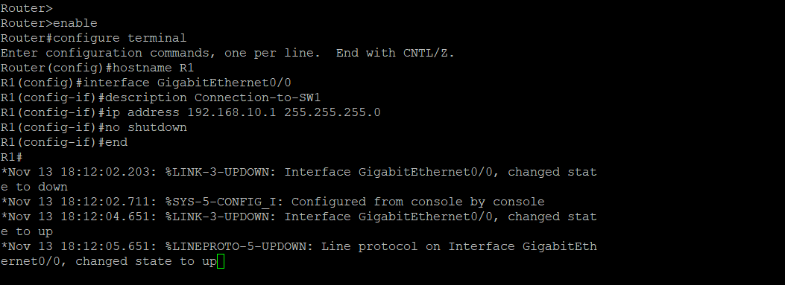 | 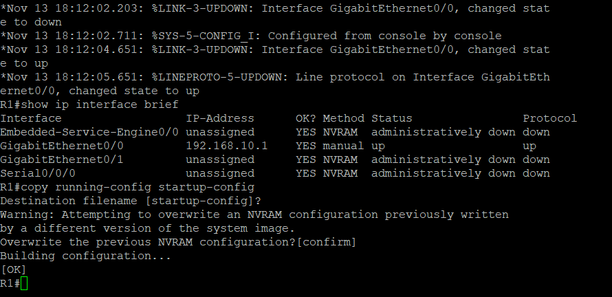 | 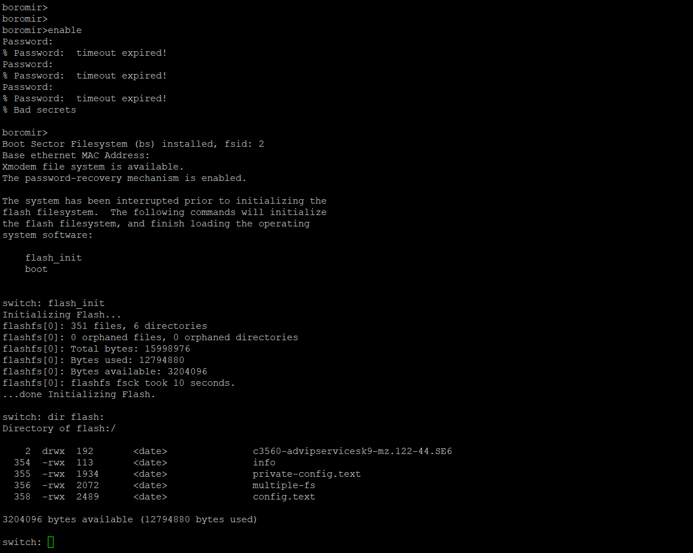 |

### 2. VLAN Segmentation and 802.1Q Trunking

Created three VLANs on `SW1`: **ADMIN (10)**, **EMPLOYEES (20)**, and **GUEST (30)**. Configured `FastEthernet0/2` as an 802.1Q trunk allowing VLANs 10, 20, and 30. The Windows laptop attaches to `FastEthernet0/1`, an access port assigned to a different VLAN for each test.

**Representative switch configuration:**

```cisco
vlan 10
 name ADMIN
vlan 20
 name EMPLOYEES
vlan 30
 name GUEST
!
interface FastEthernet0/2
 description Trunk-to-R1
 switchport trunk encapsulation dot1q
 switchport trunk allowed vlan 10,20,30
 switchport mode trunk
!
interface FastEthernet0/1
 description Windows-Laptop
 switchport mode access
 switchport access vlan 30
```

The final switch configuration shows the laptop port in VLAN 30; it was temporarily changed to VLANs 10 and 20 for earlier tests.

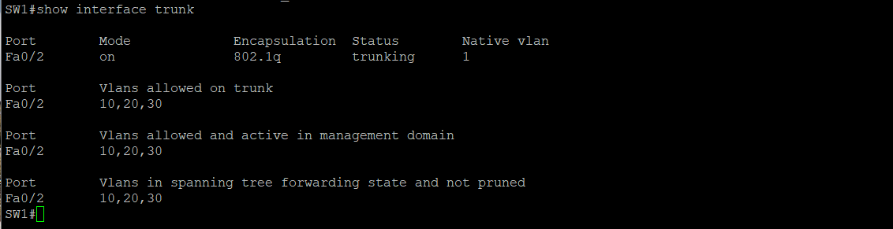

### 3. Router-on-a-Stick Gateways

Moved the initial `192.168.10.1/24` address from physical `Gi0/0` to the VLAN 10 subinterface. Created three tagged subinterfaces on the Cisco 1921:

```cisco
interface GigabitEthernet0/0
 no ip address
 no shutdown
!
interface GigabitEthernet0/0.10
 encapsulation dot1Q 10
 ip address 192.168.10.1 255.255.255.0
!
interface GigabitEthernet0/0.20
 encapsulation dot1Q 20
 ip address 192.168.20.1 255.255.255.0
!
interface GigabitEthernet0/0.30
 encapsulation dot1Q 30
 ip address 192.168.30.1 255.255.255.0
```

`show ip interface brief` showed all three subinterfaces **up/up**.

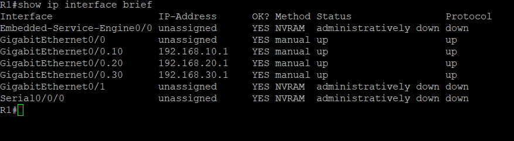

### 4. Per-VLAN Connectivity Tests

Changed the laptop's access VLAN and its IPv4 configuration as needed, then pinged the corresponding router gateway. All three final gateway tests returned **4 replies, 0 lost**.

| Test | Result | Evidence |
| --- | --- | --- |
| VLAN 10 laptop → `192.168.10.1` | 0% loss | [VLAN 10 ping](screenshots/06-vlan10-connectivity.png) |
| VLAN 20 laptop → `192.168.20.1` | 0% loss | [VLAN 20 ping](screenshots/07-vlan20-connectivity.png) |
| VLAN 30 laptop → `192.168.30.1` | 0% loss | [VLAN 30 ping](screenshots/08-vlan30-connectivity.png) |

<details>
<summary>View connectivity screenshots</summary>

**VLAN 10**

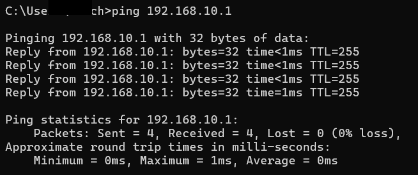

**VLAN 20**

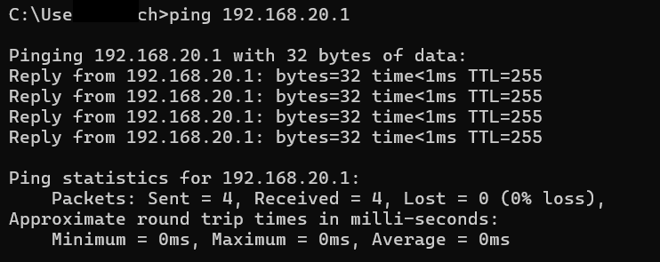

**VLAN 30**

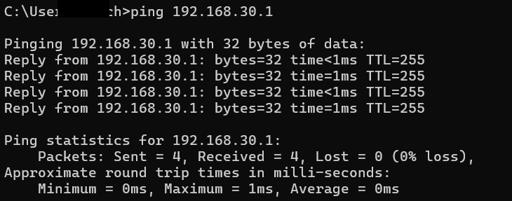

</details>

### 5. DHCP Address Assignment

Configured separate DHCP pools on `R1` for each VLAN, excluding `.1` through `.20` from dynamic allocation. Example:

```cisco
ip dhcp excluded-address 192.168.30.1 192.168.30.20
ip dhcp pool GUEST
 network 192.168.30.0 255.255.255.0
 default-router 192.168.30.1
 dns-server 8.8.8.8
```

After switching Windows Ethernet to automatic addressing, the laptop received **`192.168.30.21/24`** with gateway **`192.168.30.1`** and successfully pinged the gateway. The ADMIN and EMPLOYEES DHCP pools were configured but their leases were **not separately demonstrated** in the captured evidence.

| DHCP address received | DHCP client gateway ping |
| --- | --- |
| 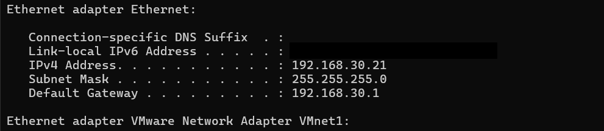 | 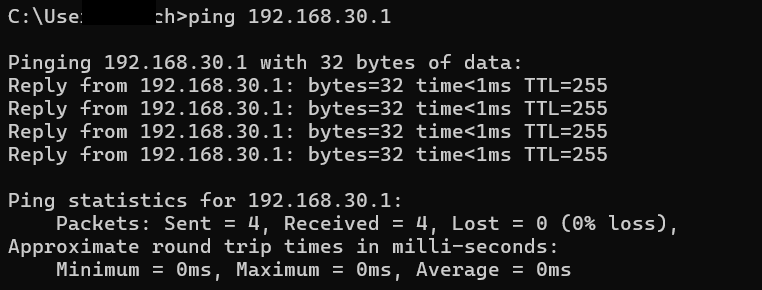 |

### 6. SSH Remote Management

Configured the Cisco 1921 for SSH version 2 with local-user authentication and tested a remote login from Windows PowerShell. The SSH session reached `R1#`, and `show ip ssh` confirmed SSH v2.

**Representative router configuration (credentials omitted):**

```cisco
ip domain-name homelab.local
! Local privilege-15 user configured; secret intentionally omitted.
ip ssh version 2
line vty 0 4
 login local
 transport input ssh
```

The router's older IOS only offered legacy SSH algorithms. The Windows OpenSSH client initially rejected the connection; the successful lab connection enabled the required algorithms **for that command only**, rather than weakening the client globally. These legacy algorithms are not suitable for production deployment.

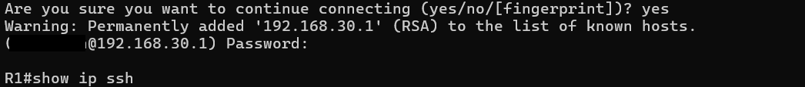

### 7. Guest-to-Admin ACL

Created an inbound extended ACL on router subinterface `Gi0/0.30` to block **GUEST (VLAN 30)** traffic headed to **ADMIN (VLAN 10)**, while permitting other IP traffic:

```cisco
ip access-list extended GUEST_RESTRICTIONS
 deny ip 192.168.30.0 0.0.0.255 192.168.10.0 0.0.0.255
 permit ip any any
!
interface GigabitEthernet0/0.30
 ip access-group GUEST_RESTRICTIONS in
```

**Test and troubleshooting:** The initial Windows ping failed, but the ACL deny counter showed no matches. `tracert` revealed Windows was using the home Wi-Fi route instead of the isolated Ethernet lab. Disabled Wi-Fi and forced the test source IP with:

```powershell
ping -S 192.168.30.21 192.168.10.1
```

The ACL's deny counter then displayed **5 matches**, confirming that the intended guest-to-admin test traffic reached the Cisco router and matched the deny rule.

| Applied ACL | Deny-rule hit counter |
| --- | --- |
| 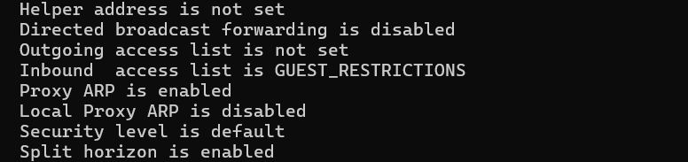 | 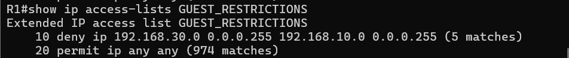 |

> The denied destination in this test was the router's ADMIN gateway (`192.168.10.1`), not a second ADMIN endpoint. The verified ACL hit counter supports this controlled test; a two-client inter-VLAN isolation test is a future enhancement.

### 8. Switch Port Security

Enabled port security on `SW1 FastEthernet0/1`, allowing one secure MAC address and using **sticky MAC learning** with `restrict` violation behavior:

```cisco
interface FastEthernet0/1
 switchport mode access
 switchport port-security
 switchport port-security maximum 1
 switchport port-security mac-address sticky
 switchport port-security violation restrict
```

`show port-security interface FastEthernet0/1` reported:

- Port security: **Enabled**
- Port status: **Secure-up**
- Violation mode: **Restrict**
- Maximum secure MAC addresses: **1**
- Sticky MAC addresses: **1**
- Security violation count: **0**

The `show port-security address` command confirmed a `SecureSticky` entry learned on `Fa0/1` in VLAN 30. No unauthorized-device violation was generated as part of this exercise.

| Port security settings | Sticky MAC learned |
| --- | --- |
| 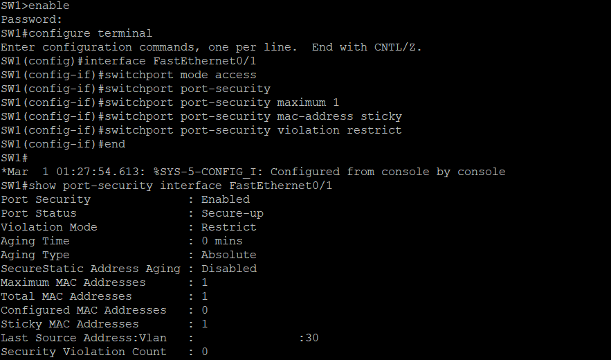 | 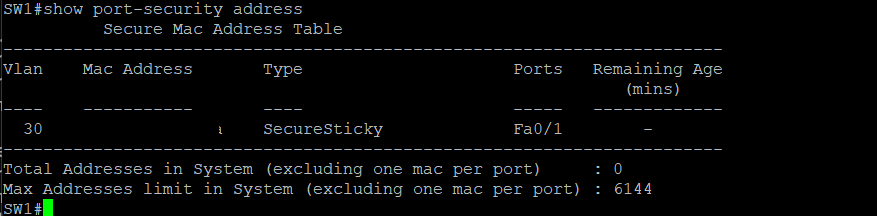 |

### 9. Final Switch Verification

Verified that VLANs 10, 20, and 30 remained active and that `Fa0/2` was trunking using 802.1Q, with those VLANs allowed and in the forwarding state. Saved router and switch configurations using `copy running-config startup-config`.

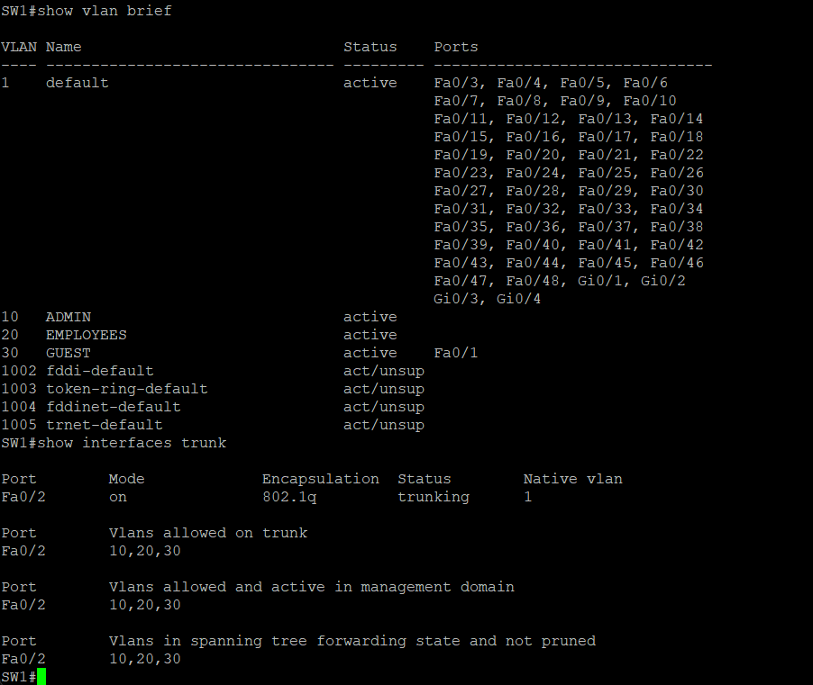

## Validation Summary

| Control / capability | Evidence | Result |
| --- | --- | --- |
| Physical router-switch-laptop links | Router interface up/up; successful client gateway pings | **Verified** |
| Three VLANs on Catalyst 3560 | `show vlan brief` | **Verified** |
| 802.1Q trunk on `Fa0/2` | `show interfaces trunk` | **Verified** |
| Three tagged router subinterfaces | `show ip interface brief` | **Verified** |
| Each VLAN's gateway reachability | Three client ping tests, 0% loss | **Verified individually** |
| DHCP on VLAN 30 | Client received `192.168.30.21` and correct gateway | **Verified** |
| DHCP pools on VLANs 10 and 20 | Router commands entered | **Configured; leases not individually tested** |
| SSH v2 remote access | Successful Windows → R1 SSH login | **Verified (legacy algorithm exception)** |
| Guest → Admin ACL | Applied inbound; deny rule with 5 matches | **Verified for tested gateway destination** |
| Port security / sticky MAC | `Secure-up`, one learned MAC, zero violations | **Verified configuration and learning** |
| Unauthorized-device port-security violation | No test performed | **Not yet tested** |
| Simultaneous two-client inter-VLAN communication | Single endpoint available | **Not yet tested** |

## Troubleshooting and Lessons Learned

1. **Used switch with an unknown password:** Used physical-console recovery to regain administrative access without blindly erasing the old configuration.
2. **Router-on-a-stick requires tagged interfaces:** Moved the initial untagged interface IP to `Gi0/0.10` and added subinterfaces for VLANs 20 and 30.
3. **Initial VLAN 20 ping lost packets:** Retested after the port/IP change and confirmed 0% loss.
4. **DHCP required matching VLAN placement:** Set Windows Ethernet to obtain IP and DNS automatically and verified a VLAN 30 lease from R1.
5. **SSH algorithm mismatch:** Diagnosed legacy key-exchange/host-key negotiation on an older Cisco IOS; used per-session client compatibility options for testing only.
6. **ACL false lead caused by Windows routing:** Home Wi-Fi sent initial test traffic via the wrong gateway. Turned off Wi-Fi and explicitly selected the lab Ethernet source address; the ACL deny counter then incremented.

## Possible Next Improvements

- Test DHCP clients on VLANs 10 and 20, not just VLAN 30.
- Add a second endpoint/VM bridge for simultaneous inter-VLAN traffic tests.
- Restrict SSH administration to a dedicated management VLAN and test the ACL behavior.
- Test an unauthorized MAC on an access port to demonstrate a `restrict` violation.
- Capture Wireshark evidence of DHCP, ARP, ICMP, and 802.1Q where supported.
- Disable unnecessary switch services; document sanitized final configurations.
- Expand to OSPF and multi-router routing when additional cables are available.

## Skills Demonstrated

**Cisco IOS CLI · Physical network cabling · Catalyst switching · VLAN segmentation · IEEE 802.1Q trunks · Router-on-a-Stick · IPv4 subnetting · DHCP · SSH · Extended ACLs · Port security · Sticky MAC · Network troubleshooting · Evidence-based technical documentation**

---

*All evidence shown was captured from the physical lab. Configuration excerpts intentionally omit credentials and password hashes.*
