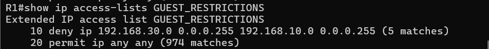

# Cisco Enterprise Network & Security Lab — Screenshot Index

These screenshots document real configuration and verification on a Cisco 1921 router and Catalyst 3560 switch.

| File | Evidence |
|---|---|
| `screenshots/01-router-initial-interface-config.png` | Initial physical router interface configuration (before migration to VLAN subinterfaces) |
| `screenshots/02-router-interface-up-and-save.png` | Router Gi0/0 up/up and initial configuration saved |
| `screenshots/03-switch-password-recovery.png` | Used switch boot loader to begin recovery of purchased used switch |
| `screenshots/04-switch-8021q-trunk.png` | Fa0/2 trunk operational for VLANs 10, 20, and 30 |
| `screenshots/05-router-vlan-subinterfaces.png` | Router-on-a-stick Gi0/0.10, .20, and .30 are up/up |
| `screenshots/06-vlan10-connectivity.png` | VLAN 10 gateway ping successful |
| `screenshots/07-vlan20-connectivity.png` | VLAN 20 gateway ping successful |
| `screenshots/08-vlan30-connectivity.png` | VLAN 30 gateway ping successful |
| `screenshots/09-dhcp-vlan30-lease.png` | Windows assigned 192.168.30.21 via DHCP, gateway 192.168.30.1 |
| `screenshots/10-dhcp-vlan30-ping.png` | Connectivity after DHCP lease |
| `screenshots/11-ssh-router-login.png` | Successful SSH session to R1 from Windows |
| `screenshots/12-acl-applied-vlan30.png` | ACL GUEST_RESTRICTIONS applied inbound to Gi0/0.30 |
| `screenshots/13-acl-deny-counter-verified.png` | Five ACL deny matches after forced Ethernet test |
| `screenshots/14-port-security-enabled.png` | Port-security on Fa0/1 enabled, one sticky MAC, restrict, zero violations |
| `screenshots/15-sticky-mac-learned.png` | Sticky MAC address learned on Fa0/1 |
| `screenshots/16-final-vlans-and-trunk.png` | Final VLAN list and operational 802.1Q trunk |

## Evidence notes

- VLAN connectivity screenshots are gateway tests performed while the single laptop was moved between VLANs by changing switch port membership. They are **not** simultaneous multi-host inter-VLAN tests.
- DHCP address assignment is explicitly verified for VLAN 30 only.
- Port security is shown enabled and learning one sticky MAC. No unauthorized-MAC violation was generated.
- ACL evidence: the deny counter registered five matches for guest-to-admin destination traffic after Wi-Fi was disabled and a source-specific ping was used.

## GitHub usage

Upload this `screenshots/` folder into the repository, then reference an image using:

```markdown

```

Some screenshots have permanent black-box redactions over device identifiers and local usernames.
